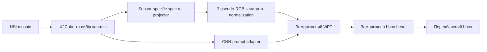
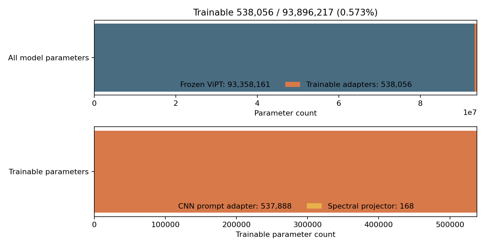
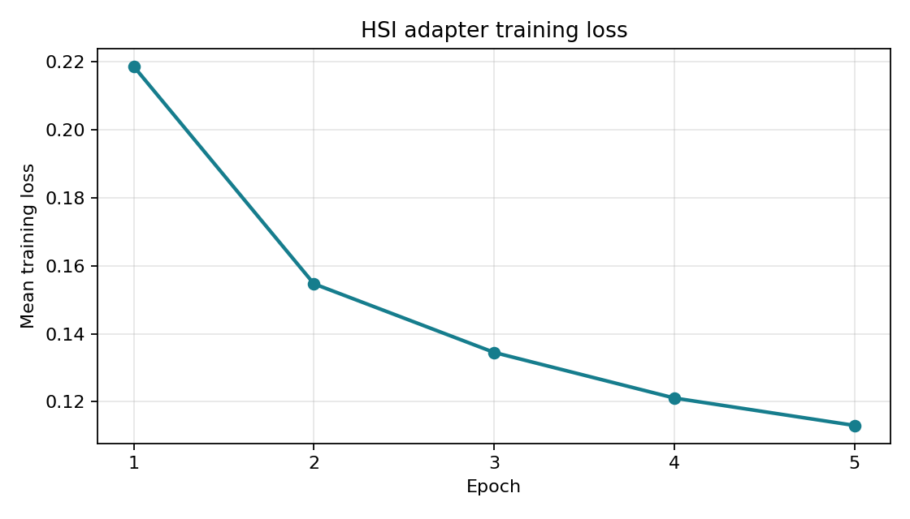
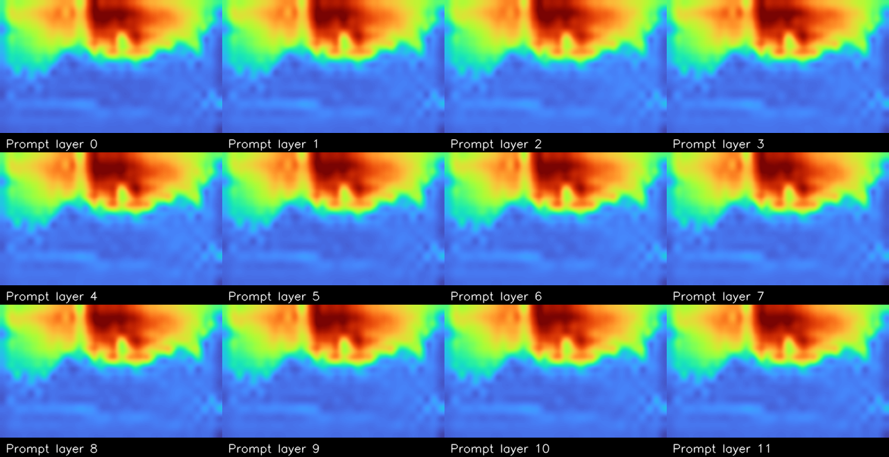
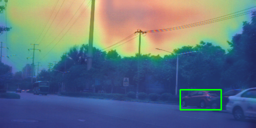
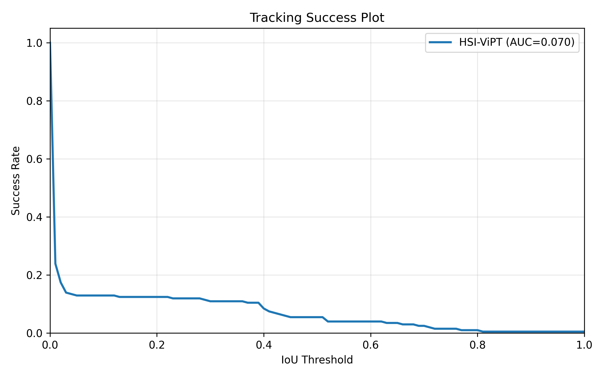
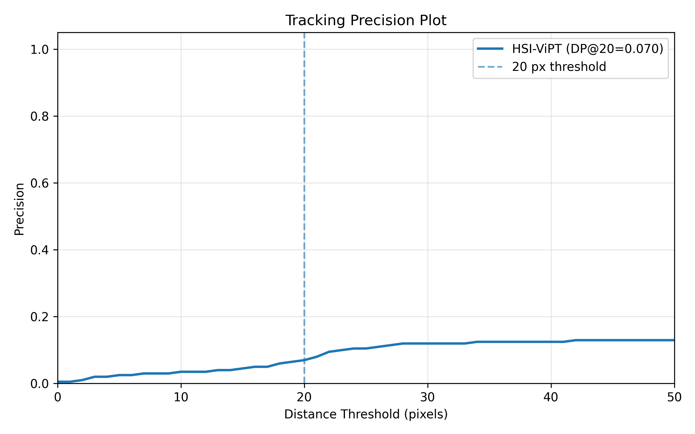
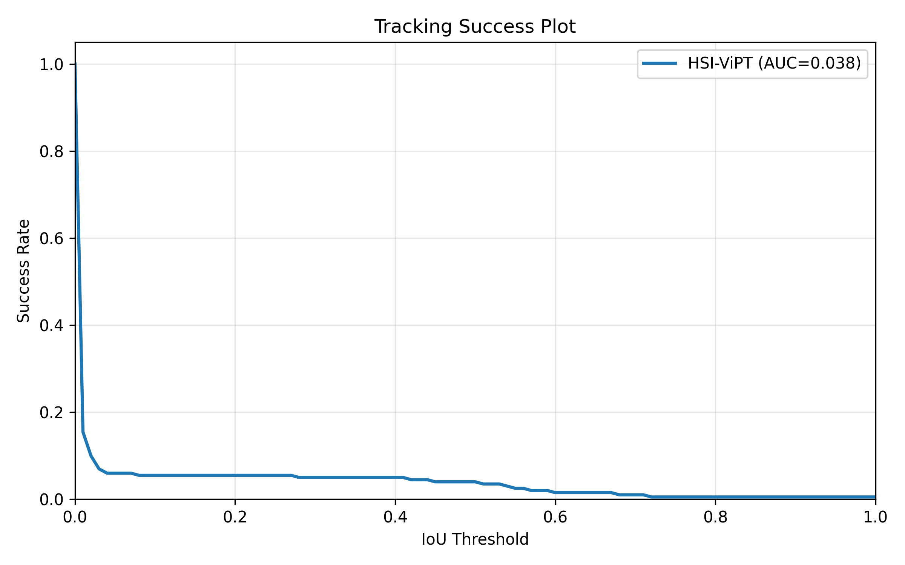
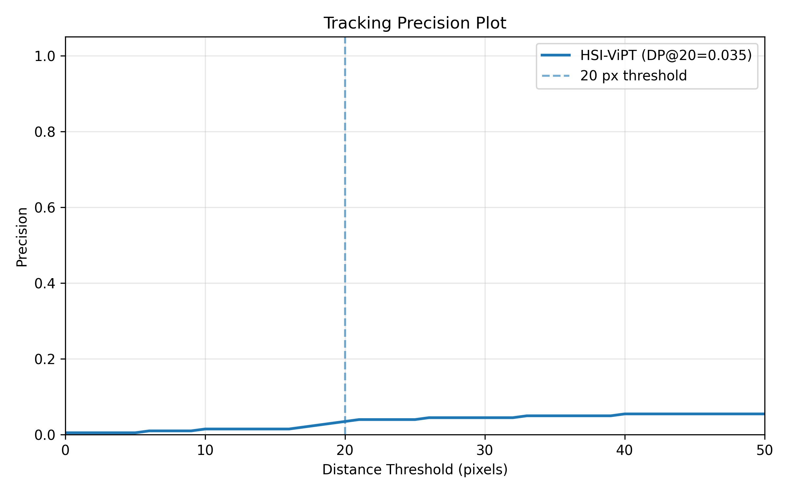
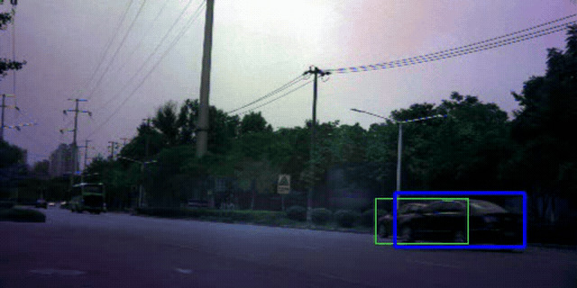

# Гіперспектральний трекінг об'єктів

Експериментальний HSI-трекер для HOT2026. Він перетворює спектральні мозаїки камер VIS, NIR або RedNIR на куби з каналами спектра, подає їх до адаптованого ViPT і повертає bbox об'єкта від кадру до кадру. Початковий bbox задається для першого кадру.

Репозиторій містить preprocessing, HSI loader, адаптацію ViPT, навчання адаптерів, оцінювання, окремі RGB/false-color демонстрації та результати експериментів. HOT2026 data і завантажені модельні ваги не включені до Git.

## Автори та матеріали проєкту

- **Дарина Ничипорук (33%)** — X2Cube pipeline, PyTorch Dataset/DataLoader та dataset preprocesing.
- **Богдан Колодчак (34%)** — spectral projector, інтеграція ViPT, CNN Prompt-Adapter та візуалізація відео.
- **Тетяна Мороз (33%)** — аналіз результатів, метрики AUC/DP@20, експорт CSV і baseline scripts.

Розподіл внеску наведено в поданій [пропозиції проєкту](docs/proposal/proposal_Kolodchak_Nuchuporyk_Moroz.pdf). Матеріали до midterm-презентації мають зберігатися в [docs/slides/](docs/slides/); сам файл презентації наразі не включений до цього checkout.

## Поточний стан

- HSI VIS pipeline проходить від мозаїки до трекінгу та записує відео, CSV передбачень, метрики й графіки.
- Зафіксований запуск навчався п'ять епох на двох повних HSI-VIS відео: 1 428 валідних сусідніх пар кадрів за епоху, batch size 1. Імена цих sequence не записані у збереженій history.
- На окремій 201-кадровій `automobile4` навчені адаптери покращили метрики відносно непідлаштованих, але абсолютна точність лишилася низькою й трекер може дрейфувати на схожий об'єкт.
- Автоматичної крос-валідації, validation loop під час навчання, вибору best epoch, scheduler, optimizer resume та AMP поки немає.
- RGB/false-color ViPT та SAMURAI результати подані окремо: це не вимірювання якості HSI адаптера.

## Як працює HSI-трекер



X2Cube розкладає один 2D mosaic кадр у куб H×W×C. VIS використовує 16 каналів із блоків 4×4, NIR — 25 каналів із блоків 5×5, RedNIR — 15 корисних каналів із блока 4×4 (порожній канал відкидається). Spectral projector — навчувані 1×1 згортки, окремі для сенсорів; спочатку кожен pseudo-RGB канал бере низьку, середню або високу спектральну смугу.

CNN prompt adapter формує просторові prompt-токени для ViPT transformer blocks. У поточній ViT-Base конфігурації це 12 наборів prompt-ів з embedding 768. Backbone та prediction head ViPT завантажуються з RGB-T checkpoint і заморожуються; optimizer оновлює projector та prompt adapter. Для кожного запуску використовується stem відповідного сенсора.

## Навчання

`HSIFramePairDataset` створює приклади з сусідніх кадрів `i` та `i+1`, якщо bbox обох кадрів валідні. Перший кадр стає template, наступний — search; bbox наступного кадру перетворюється у координати search crop. DataLoader перемішує пари на кожній епосі.

Зафіксована конфігурація п'яти епох: 1 428 optimizer steps/епоху, batch size 1, AdamW, learning rate `1e-4`, gradient clipping `0.1`; loss — Smooth L1 плюс `2 × (1 - GIoU)`. `mean_loss` — середнє сумарного loss за кроками епохи, не tracking metric і не validation loss.

За підрахунком поточної VIS моделі: 93 896 217 параметрів загалом, з них 93 358 161 заморожені параметри ViPT і 538 056 параметрів projector/CNN adapter (0.573%). Історія: [training_history.json](models/hsi_adapters/training_history.json); checkpoint `models/hsi_adapters/adapter_latest.pth` локальний та ігнорується Git.



### Loss та візуальна діагностика



Loss знизився з 0.2186 до 0.1130 (приблизно на 48%). Це тренувальна крива на тих самих парах; вона не доводить узагальнення на нові відео.

Початкова pseudo-RGB проєкція VIS показана нижче. Це три спектральні смуги, відображені у RGB, а не звичайне RGB фото й не навчена проєкція.


Наступні prompt activation images отримані до навчання адаптера. Це діагностика випадкової ініціалізації, а не learned attention до цілі.





## Перевірені результати HSI

Навчені й непідлаштовані ваги запускалися на `automobile4` (VIS, 16 каналів, 201 кадр, CPU). За записом цього експерименту `automobile4` не входила до двох тренувальних sequence. Це одне окреме тестове відео, а не повна оцінка HOT2026.

| Метрика | Без адаптера | З навченим адаптером |
|---|---:|---:|
| AUC | 0.0377 | 0.0702 |
| DP@20 | 0.0348 | 0.0697 |
| Mean IoU | 0.0335 | 0.0668 |
| Mean center error | 215.6 px | 155.6 px |

AUC, DP@20 та IoU зросли приблизно вдвічі, похибка центра знизилася приблизно на 27.8%. Абсолютні значення лишаються низькими: трекер може спершу вести ціль, перейти на схожий об'єкт і втратити її.

**Навчений адаптер — success curve:**



**Навчений адаптер — precision curve:**



**Для порівняння, без навчених адаптерів:**

| Success curve | Precision curve |
|---|---|
|  |  |

**Трекінг на `automobile4`:** зелена рамка — ground truth, червона — передбачення.



Повні MP4/CSV/JSON виходи лежать локально в `results/full-model/automobile4_VIS/test_trained/` і `test_untrained/`; ці generated folders ігноруються Git.

## Запуск HSI pipeline

### Дані

Кожна HSI sequence має містити одноканальні мозаїки `.png`, `.tif` або `.tiff` та файл `groundtruth_rect.txt` з одним рядком `x y width height` на кадр. Для inference на validation sequence потрібен `init_rect.txt` із початковим bbox. Trainer рекурсивно шукає sequence folders усередині `--data`.

HOT2026 поширюють організатори окремо. Перевір умови змагання перед використанням або передаванням даних; не коміть датасет у цей репозиторій.

### Середовище та залежності

Основний пакет вимагає Python 3.11+ (`pyproject.toml`):

```bash
make setup
source .venv/bin/activate
python -m pip install -e .
python -m pip install torch  # вибрати сумісну CPU/CUDA збірку на pytorch.org
pytest
```

Інтеграція з upstream ViPT має окремі залежності. Для локального CPU-режиму створи середовище, клонув upstream checkout і встанови pinned CPU dependencies:

```bash
conda create -n vipt python=3.7 -y
conda activate vipt
git clone https://github.com/jiawen-zhu/ViPT.git third_party/ViPT
python -m pip install -r requirements-vipt-cpu.txt
python scripts/cnn-adapter/patch_vipt_hsi.py
```

Для Colab `requirements-vipt-colab.txt` навмисно не перевстановлює PyTorch. Обери GPU runtime, встанови Colab requirements, клонуй upstream ViPT у `third_party/ViPT`, поклади `ViPT_deep_rgbt.pth` у `third_party/ViPT/models/` і запусти patcher:

```bash
python -m pip install -r requirements-vipt-colab.txt
python -c "import torch; print(torch.__version__, torch.cuda.is_available())"
git clone https://github.com/jiawen-zhu/ViPT.git third_party/ViPT
python scripts/cnn-adapter/patch_vipt_hsi.py
```

CUDA check має показати `True`. Не запускай `third_party/ViPT/install_vipt.sh` у Colab GPU runtime: він може замінити CUDA-сумісний PyTorch. Upstream ViPT старий; patcher додає HSI external prompts і compatibility fixes, але різні версії Python/PyTorch можуть вимагати додаткового налагодження.

### Навчити адаптери

```bash
python scripts/cnn-adapter/train_hsi_adapters.py \
	--data /path/to/HOT2026/training/HSI-VIS \
	--sensor VIS \
	--base-checkpoint third_party/ViPT/models/ViPT_deep_rgbt.pth \
	--epochs 5 \
	--device auto \
	--output-dir results/full-model/hot10_VIS/training
```

Для pipeline smoke test використовуй `--max-steps 1`; це не повноцінне навчання. Повний запуск записує `adapter_latest.pth` і `training_history.json` у `--output-dir`, а також оновлює локальні `models/hsi_adapters/`. Smoke-режим не перезаписує останні повні ваги. За замовчуванням кожен тренувальний запуск починає з base ViPT checkpoint; resume optimizer state не реалізований.

### Запустити tracker та оцінити

У test mode перший GT bbox лише ініціалізує tracker; решту GT застосовано після передбачень для оцінювання:

```bash
python scripts/cnn-adapter/run_hsi_vipt.py \
	--data /path/to/labeled_sequence \
	--sensor VIS \
	--test-data \
	--adapter-checkpoint models/hsi_adapters/adapter_latest.pth \
	--output-dir results/full-model/example_VIS/test \
	--device auto
```

Для validation sequence з одним `init_rect.txt`:

```bash
python scripts/cnn-adapter/run_hsi_vipt.py \
	--data /path/to/validation_sequence \
	--sensor VIS \
	--validation-data \
	--adapter-checkpoint models/hsi_adapters/adapter_latest.pth \
	--output-dir results/full-model/example_VIS/validation \
	--device auto
```

Test mode зберігає `tracking.mp4`, `predictions.csv`, `metrics.json`, `success_plot.png` та `precision_plot.png`. Validation mode без повного GT не рахує метрики точності. Якщо `--adapter-checkpoint` не вказаний, inference шукає `models/hsi_adapters/adapter_latest.pth`.

## Скрипти

| Шлях | Призначення |
|---|---|
| `scripts/cnn-adapter/patch_vipt_hsi.py` | Підготовка upstream ViPT до HSI prompts; викликає CPU compatibility patch і змінює transformer forward path. |
| `scripts/cnn-adapter/train_hsi_adapters.py` | CLI навчання spectral projector і CNN prompt adapter. |
| `scripts/cnn-adapter/run_hsi_vipt.py` | HSI tracking у validation/test режимах; експортує відео, передбачення, метрики та криві. |
| `scripts/cnn-adapter/visualize_cnn_prompts.py` | Pseudo-RGB та prompt activation diagnostics; activation maps самі по собі не є learned attention. |
| `scripts/preprocessing-layer/diagnose_hsi_data.py` | Перевірка мозаїки, X2Cube, кількості каналів, bbox та парних false-color кадрів. |
| `scripts/projector/visualize_spectral_projection.py` | Рендер spectral projection у pseudo-RGB відео та JSON diagnostics. |
| `scripts/vipt_init-false-color/inspect_vipt.py` | Звіт про upstream checkout, конфігурації, checkpoint і Python runtime. |
| `scripts/vipt_init-false-color/patch_vipt_cpu.py` | CPU/device compatibility patch для upstream ViPT; використовується HSI patcher-ом. |
| `scripts/vipt_init-false-color/preview_init_frame.py` | Перший кадр false-color sequence з початковою bbox. |
| `scripts/vipt_init-false-color/run_vipt.py` | Окремий RGB/false-color ViPT runner, не HSI adapter pipeline. |
| `scripts/samurai_baseline_scripts/install_samurai.sh` | Встановлення окремого SAMURAI false-color baseline. |
| `scripts/samurai_baseline_scripts/run_samurai.py` | SAMURAI tracking на JPG false-color sequence. |
| `scripts/demo_plots.py` | Демонстрація графіків на штучних bbox, не результат реального експерименту. |

## Структура репозиторію

| Каталог | Вміст |
|---|---|
| `config/` | YAML-конфігурація шляхів, сенсорів, моделі та метрик. |
| `data/` | Локальні HOT2026 sequence, архіви й проміжні дані; дані не комітяться. |
| `docs/` | Proposal PDF, правила внеску, матеріали постера та презентації. |
| `models/` | Локальні HSI adapter checkpoints; ваги виключені з Git. |
| `notebooks/` | `01_data_and_preprocessing.ipynb` для огляду даних; `02_hsi_adapter_training.ipynb` для тренування та короткого inference. |
| `photos_for_readme/` | Копії figure-ів і короткий GIF, доступні GitHub README. |
| `results/` | CNN diagnostics, projector/convolution experiments, HSI full-model, RGB smoke runs, метрики та visualizations. Більшість generated artifacts ігнорується Git. |
| `scripts/` | CLI та experiment helper scripts, описані вище. |
| `src/hsi_tracking/` | Повторно використовуваний код: `data/` (loader/X2Cube), `models/` (projector/adapter/tracker), training, evaluation, visualization, config та baselines. |
| `tests/` | Unit tests для конфігурації, датасету, метрик, projector, prompt adapter та visualization. |
| `third_party/ViPT/` | Окремо завантажений upstream ViPT checkout; сторонній код і ваги не є вмістом цього проєкту для Git. |

Ключові модулі `src/hsi_tracking/`:

| Файл | Призначення |
|---|---|
| `data/x2cube.py` | Sensor specs, перетворення mosaic→cube та вибір спектральних каналів. |
| `data/dataset.py` | Завантаження HSI sequence, bbox annotations та optional false-color frames. |
| `models/spectral_projector.py` | Sensor-specific 1×1 convolution від HSI каналів до трьох pseudo-RGB каналів. |
| `models/prompt_adapter.py` | CNN residual adapter і prompt heads для ViPT transformer layers. |
| `models/tracker.py` | Заморожений ViPT плюс trainable adapters, checkpoint I/O та sequence tracking. |
| `training.py` | Sequence discovery, adjacent-frame pair dataset, loss, optimizer і artifact saving. |
| `evaluation.py` | IoU, center error, success/AUC і precision/DP@20. |
| `visualization.py` | Tracking plots і початкові кадри з bbox. |
| `baselines.py` | Допоміжні static-box/false-color baseline entry points. |
| `config.py` | YAML configuration loading. |

Додаткові довідки: [project proposal](docs/proposal/README.md), [data layout](data/README.md), [model artifacts](models/README.md), [notebooks](notebooks/README.md), [experiments](results/experiments.md), [contribution rules](docs/CONTRIBUTING.md). Файли кореня: `pyproject.toml` — пакет і pytest/ruff конфігурація; `Makefile` — setup/lint/test; `requirements*.txt` — залежності для основного пакета, локального ViPT CPU та Colab GPU; `LICENSE` — ліцензія цього репозиторію. `Miniforge3.sh`, якщо присутній локально, є installer-файлом, а не частиною tracker pipeline.

## Окрема RGB/false-color демонстрація

`results/runs/ball_test/metrics.json` містить 625-кадровий CPU smoke test: звичайний RGB кадр дублювався у два RGB входи ViPT. Його AUC — 0.6896, DP@20 — 0.9552. Це не HSI tracking і результат не можна напряму порівнювати з HSI-ViPT. `results/runs/doll3_validation/` має 370-кадровий initialization-only validation run без повного GT, тому accuracy metrics відсутні.

## Обмеження та наступні перевірки

- Документовано лише одну held-out HSI sequence; потрібне оцінювання на більшій validation вибірці.
- Пошуковий crop у навчанні центрується за GT попереднього кадру; модель не тренується на накопичених власних помилках tracker-а. Це може сприяти drift на схожі об'єкти.
- Немає cross-validation, validation loop, early stopping, scheduler, optimizer resume або AMP.
- HSI prompt pipeline — адаптація RGB-T ViPT, не офіційна HSI модель чи HSI checkpoint.
- Перевіряй умови HOT2026 і ліцензії upstream ViPT/SAMURAI перед розповсюдженням даних, ваг або стороннього коду.

Для розробки: `make lint` і `make test`. Перед повним запуском перевір дані та checkpoint; для початкової перевірки pipeline використовуй `--max-steps 1`.
