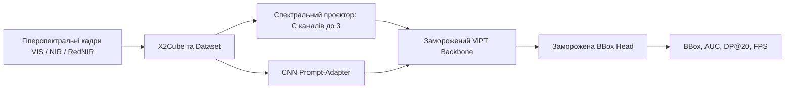

# Hyperspectral Object Tracking

Параметрично-ефективний трекінг об'єктів у гіперспектральному відео для HOT2026. Система отримує гіперспектральний куб і BBox цілі на першому кадрі, а повертає BBox для наступних кадрів.

Повний [пропоузал проєкту](proposal_Kolodchak_Nuchuporyk_Moroz.pdf).

## Підхід

Поточний план: використати заморожені ViPT backbone і prediction head, адаптувавши гіперспектральний вхід легкими модулями, що навчаються.



Мета пропоузалу: trainable-модулі мають займати менш ніж 3% параметрів. Оцінювання планується окремо для VIS (16 каналів), NIR (25) і RedNIR (15), з порівнянням зі статичною рамкою, false-color SAMURAI та доступними HSI-трекерами.

## Дані та ваги

Використовується HOT2026. Датасет завантажується за правилами змагання; сирі дані, проміжні куби й ваги моделей не додаються до Git. Інструкції та структура каталогів описані в [data/README.md](data/README.md) і [models/README.md](models/README.md).

## Налаштування

Створіть середовище й активуйте його. Потім установіть у нього збірку PyTorch, сумісну з вашою системою та CUDA, за інструкціями на [pytorch.org](https://pytorch.org/get-started/locally/):

```bash
make setup
source .venv/bin/activate
python -m pip install torch  # choose the matching command from pytorch.org for CUDA support
pytest
```

Конфігурація проєкту: [config/default.yaml](config/default.yaml). Для HSI вже є X2Cube/loader, projector, CNN Prompt-Adapter, experimental ViPT integration і мінімальний adapter-training loop. Як їх запускати й що ще обмежене описано в [інструкції CNN adapter](scripts/cnn-adapter/README.md). Це поки прототип, а не перевірений результат HOT challenge.

## Usage: запуск ViPT на послідовності

Один скрипт `scripts/run_vipt.py` запускає будь-яку папку з послідовністю кадрів. Потрібні кадри у форматі JPG/PNG; їхні імена сортуються за номером. Запускай команди з кореня проєкту в Conda-середовищі `vipt`.

### Одноразове налаштування

Якщо `vipt` ще не створений:

```bash
conda create -n vipt python=3.7 -y
conda activate vipt
```

Якщо upstream ViPT ще не клонований:

```bash
mkdir -p third_party
git clone https://github.com/jiawen-zhu/ViPT.git third_party/ViPT
```

Потім установи CPU-залежності та застосуй CPU patch:

```bash
conda activate vipt
python -m pip install -r requirements-vipt-cpu.txt
python scripts/patch_vipt_cpu.py
```

Завантаж checkpoint `ViPT_deep_rgbt.pth` з [офіційної RGB-T папки моделей](https://drive.google.com/drive/folders/1Czgrdh4CzPLESZuETicIZkDvo1EcdZKo) у `third_party/ViPT/models/ViPT_deep_rgbt.pth`. Це PyTorch checkpoint близько 357 MiB у ZIP-контейнері; вручну його не розпаковуй.

### Validation mode

Validation-папка має містити кадри й `init_rect.txt` з початковою рамкою `x y width height`. Наприклад:

```bash
python scripts/run_vipt.py --data data/doll3/ --validation-data
```

У цьому режимі модель отримує тільки початкову рамку. Скрипт зберігає відео, CSV передбачень і `metrics.json`, але не обчислює якість, бо решти ground-truth рамок немає.

### Test mode

Test-папка має містити кадри й `groundtruth_rect.txt` з одним `x y width height` рядком на кадр; `description.txt` необов'язковий. Наприклад:

```bash
python scripts/run_vipt.py --data data/ball/ --test-data
```

Перший рядок ground truth використовується тільки для ініціалізації на першому кадрі. Інші GT-рамки скрипт не передає трекеру: він спершу отримує передбачення, а після цього використовує GT для аналізу помилки. У відео GT рамка зелена, передбачення червоне.

Обидва режими за замовчуванням створюють файли в `results/runs/<назва-папки>_<режим>/`. У test mode це `tracking.mp4`, `predictions.csv`, `metrics.json`, `success_plot.png` (AUC) і `precision_plot.png` (DP@20). У summary також записуються mean IoU, середня похибка центра й FPS. Шлях можна змінити через `--output-dir`.

**Обмеження smoke test:** upstream RGB-T checkpoint отримує RGB, продубльований у другі три канали. Це перевіряє запуск моделі на CPU, але не є справжнім HSI-трекінгом; метрики цього режиму не слід трактувати як результат запропонованої HSI-адаптації.

## Структура репозиторію

```text
config/                  Конфігурація даних, моделі, навчання й оцінювання
data/                    Локальні raw/interim/processed дані, не для Git
docs/                    Пропоузал, постер, слайди та командні правила
models/                  Локальні checkpoint-и, не для Git
notebooks/               Дослідження даних та аналіз помилок
results/                 Метрики, передбачення й візуалізації
scripts/                 Команди запуску дослідів
src/hsi_tracking/        Python-пакет: дані, модель, тренування, оцінювання
tests/                   Автоматизовані тести
```

## Команда

| Учасник | Напрямок за пропоузалом |
|---|---|
| Ничипорук Дарина | X2Cube, Dataset/DataLoader, інтеграція BBox prediction head |
| Колодчак Богдан | Спектральний проєктор, ViPT, CNN Prompt-Adapter, бейзлайни |
| Мороз Тетяна | Метрики AUC/DP@20, аналіз, CSV та відеовізуалізація |

## Розробка

```bash
ruff check .
ruff format --check .
pytest
```

Поточний стан і план експериментів ведуться в [results/experiments.md](results/experiments.md). Правила внеску: [docs/CONTRIBUTING.md](docs/CONTRIBUTING.md).
