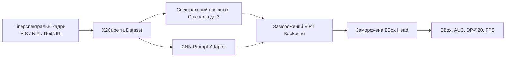

# Hyperspectral Object Tracking

Параметрично-ефективний трекінг об'єктів у гіперспектральному відео для HOT2026. Система отримує гіперспектральний куб і BBox цілі на першому кадрі, а повертає BBox для наступних кадрів.

Повний [пропоузал проєкту](proposal_Kolodchak_Nuchuporyk_Moroz.pdf).

## Підхід

Поточний план: використати заморожені ViPT backbone і prediction head, адаптувавши гіперспектральний вхід легкими модулями, що навчаються.



Мета пропоузалу: trainable-модулі мають займати менш ніж 3% параметрів. Оцінювання планується окремо для VIS (16 каналів), NIR (25) і RedNIR (15), з порівнянням зі статичною рамкою, false-color SAMURAI та доступними HSI-трекерами.

## Дані та ваги

Використовується HOT2026. Датасет завантажується за правилами змагання; сирі дані, проміжні куби й ваги моделей не додаються до Git. Інструкції та структура каталогів описані в [data/README.md](data/README.md) і [models/README.md](models/README.md).

## Налаштування

Створіть середовище й активуйте його. Потім установіть у нього збірку PyTorch, сумісну з вашою системою та CUDA, за інструкціями на [pytorch.org](https://pytorch.org/get-started/locally/):

```bash
make setup
source .venv/bin/activate
python -m pip install torch  # choose the matching command from pytorch.org for CUDA support
pytest
```

Конфігурація за замовчуванням: [config/default.yaml](config/default.yaml). Навчання, конвертація HOT2026 та повний evaluation pipeline ще не реалізовані; поточний репозиторій готує відтворювану структуру для цих компонентів.

## Usage: ViPT CPU demo на doll3

Цей запуск перевіряє, що ViPT може обробити відео, видати рамки й зберегти MP4. Він використовує upstream RGB-T checkpoint, а RGB-кадр копіює у два входи моделі, тому це лише перевірка запуску, не оцінка якості й не HSI-трекінг.

Потрібні файли в `data/doll3/`: нумеровані JPG-кадри (`0001.jpg`, ...), а також `init_rect.txt` з початковою рамкою у форматі `x y width height` у пікселях. Ця папка локальна й не входить у Git; у новому клоні її треба підготувати окремо.

### Одноразове налаштування

Запускай команди з кореня репозиторію. Клон ViPT і середовище `vipt` локальні та не додаються до Git.

```bash
# Потрібно лише один раз, якщо середовища vipt ще немає:
conda create -n vipt python=3.7 -y
conda activate vipt

# Якщо third_party/ViPT ще не клонований:
mkdir -p third_party && git clone https://github.com/jiawen-zhu/ViPT.git third_party/ViPT

python -m pip install -r requirements-vipt-cpu.txt
python scripts/patch_vipt_cpu.py
python scripts/inspect_vipt.py
```

Завантаж файл `ViPT_deep_rgbt.pth` з [офіційної RGB-T папки моделей](https://drive.google.com/drive/folders/1Czgrdh4CzPLESZuETicIZkDvo1EcdZKo) та поклади його сюди:

```text
third_party/ViPT/models/ViPT_deep_rgbt.pth
```

Цей `.pth` має приблизно 357 MiB. Це checkpoint з вагами моделі, збережений у ZIP-контейнері PyTorch; **не розпаковуй його**. ViPT завантажує файл безпосередньо.

### Запуск

```bash
conda activate vipt
python scripts/run_doll3_vipt.py
```

Скрипт читає й сортує кадри, бере початкову рамку з `init_rect.txt`, ініціалізує нею ViPT на першому кадрі, а далі передає кадри трекеру без наступних ground-truth рамок. Для кожного кадру він малює передбачену рамку та confidence score і збирає відео:

```text
results/visualizations/doll3_vipt_cpu.mp4
```

Щоб змінити шляхи або FPS, наприклад:

```bash
python scripts/run_doll3_vipt.py --sequence data/doll3 --checkpoint third_party/ViPT/models/ViPT_deep_rgbt.pth --output results/visualizations/doll3.mp4 --fps 25
```

`best_score` у відео — оцінка впевненості ViPT, не метрика точності. Для вимірювання якості потрібні правильні рамки для наступних кадрів; зараз у `doll3` є лише початкова рамка.

## Структура репозиторію

```text
config/                  Конфігурація даних, моделі, навчання й оцінювання
data/                    Локальні raw/interim/processed дані, не для Git
docs/                    Пропоузал, постер, слайди та командні правила
models/                  Локальні checkpoint-и, не для Git
notebooks/               Дослідження даних та аналіз помилок
results/                 Метрики, передбачення й візуалізації
scripts/                 Команди запуску дослідів
src/hsi_tracking/        Python-пакет: дані, модель, тренування, оцінювання
tests/                   Автоматизовані тести
```

## Команда

| Учасник | Напрямок за пропоузалом |
|---|---|
| Ничипорук Дарина | X2Cube, Dataset/DataLoader, інтеграція BBox prediction head |
| Колодчак Богдан | Спектральний проєктор, ViPT, CNN Prompt-Adapter, бейзлайни |
| Мороз Тетяна | Метрики AUC/DP@20, аналіз, CSV та відеовізуалізація |

## Розробка

```bash
ruff check .
ruff format --check .
pytest
```

Поточний стан і план експериментів ведуться в [results/experiments.md](results/experiments.md). Правила внеску: [docs/CONTRIBUTING.md](docs/CONTRIBUTING.md).
